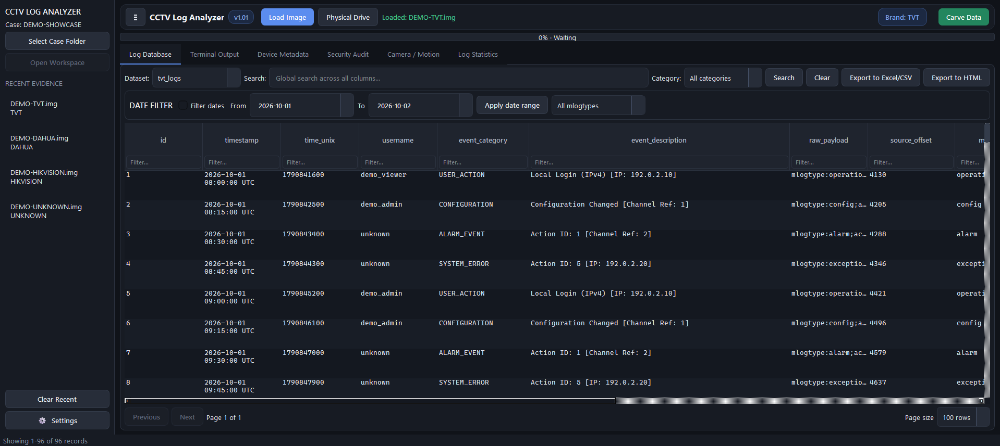
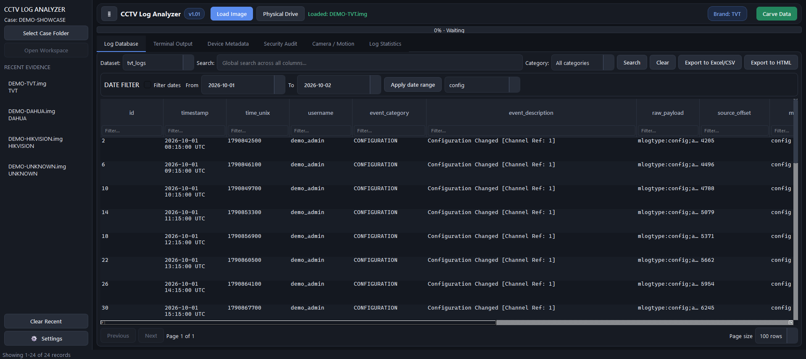
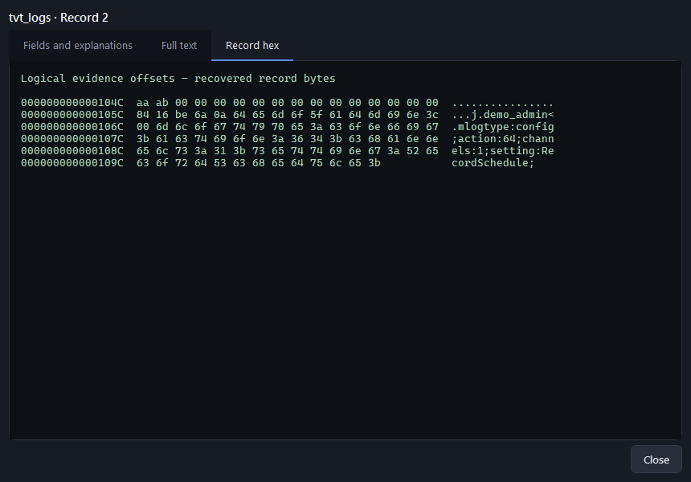
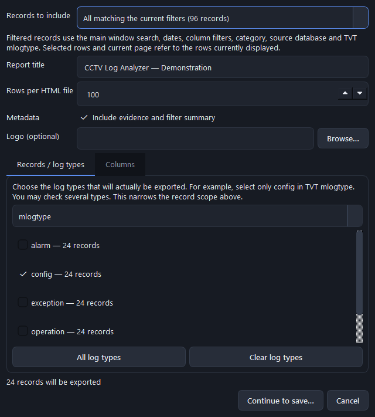
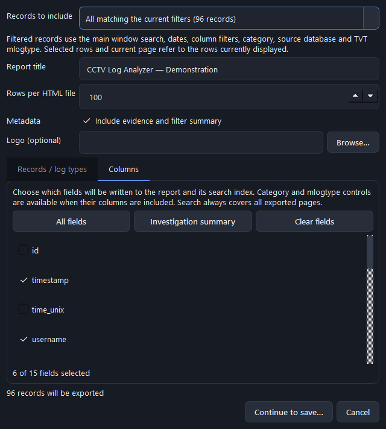
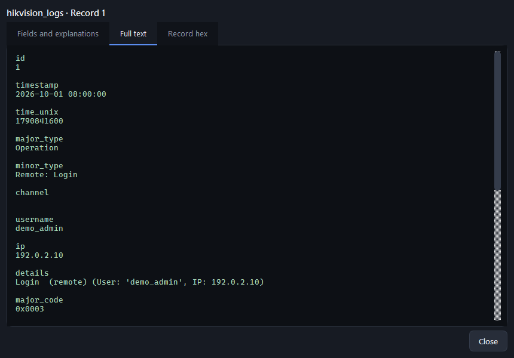
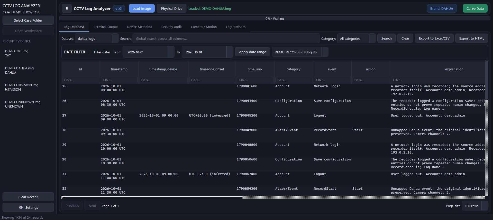
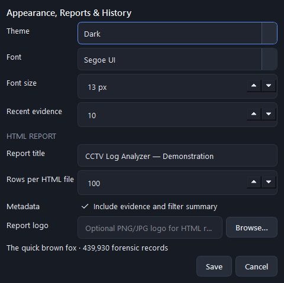
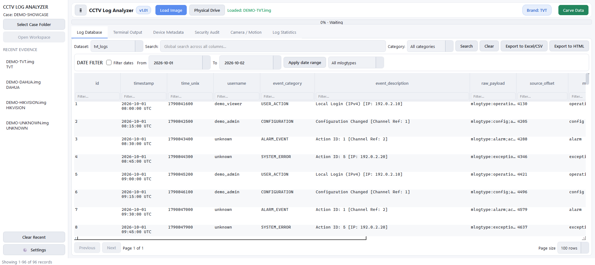
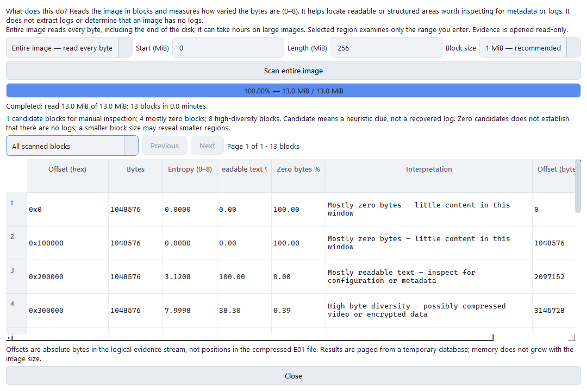

# CCTV Log Analyzer 1.01

Select a **Case Folder** in the left sidebar before starting analysis. Each
extraction creates a new workspace, even for a repeated run of the same image:

```text
Case Folder/
  case.json
  workspaces/
    Image.E01_UTC-timestamp_unique-id/
      workspace.json
      workspace.log
      databases/
      reports/
```

`workspace.log` uses UTC timestamps and records source, version, detection,
phases, progress, results, report choices/paths and failures. `workspace.json`
records status and artifacts. Entropy results are retained in `databases` too.
Reports default to `reports` with unique filenames. Recent evidence reopens its
original workspace; selecting another case does not move existing results.
For physical evidence the case must be on a different disk. AppData still stores
the application's general logs, preferences and recent list.

A PySide6 forensic workbench for identifying and extracting system logs from
Hikvision, Dahua and TVT DVR/NVR disk images. iCatch disks are identified, but
no usable logs were found on them, so no extraction is offered (see
[iCatch notes](docs/FORENSICS_ICATCH.md)). It is the successor
of [HikvisionLogAnalyzer](https://github.com/theAtropos4n6/HikvisionLogAnalyzer);
see [Origins and credits](#origins-and-credits).

Long extraction jobs can be stopped using **Cancel extraction**. Cancellation
waits for the current native read/open to return, stops at a safe boundary, and
marks the workspace as incomplete. Unfinished XFS copies use `.partial`; results
are never reported as complete after cancellation.

Hikvision datasets enable **Security Audit**, **Camera / Motion** and **Log
Statistics** in the main app. These SQL-paginated views share the main global,
column and date filters. Double-click records for full details/hex or statistics
for drilldown to matching logs. New extractions retain region/status for counts;
older databases show absent region information as not stored.

TVT includes action/type provenance, parsed payload fields and vendor SDK named
type interpretation. SDK log-type enum numbers are not assumed to be raw action
IDs. Dahua includes actor/source/configuration fields and explanations for every
JSON key, preserving undocumented values and complete original JSON.
See [SDK sources](docs/SDK_SOURCES.md) and [current status](docs/PROGRESS.md).

Version 1.01 adds a Dahua source-database filter (also applied to exports),
short explanation summaries in result rows with the full text in the
double-click record details window, and recovered-record hex there for
Hikvision and TVT. Offsets are absolute bytes in the logical image stream;
TVT `source_offset` identifies the mlogtype payload and `raw_record_offset`
identifies the captured header start. Older extraction databases must be
re-created to include raw hex. An unknown image can be surveyed using the
read-only Entropy test button: scan the entire logical image (every byte), or
choose a start and length for a region. There is no 4 GiB range cap. Block sizes
range from 64 KiB to 16 MiB; smaller blocks reveal smaller areas. Results include
plain-language interpretations and a global candidate filter with pagination.
The scan streams to a temporary SQLite database to bound memory, with byte
progress, throughput, estimated remaining time and cancellation with partial results.
Entropy is a locator for further inspection, not proof of logs or their absence.

TVT has a separate `mlogtype` selector (operation, config, alarm, exception and
any other types actually present), in addition to the interpreted category.
It filters the entire dataset and CSV/HTML exports. HTML reports also offer an
independent global mlogtype selector across all exported pages. Older derived
TVT databases gain the field from their existing raw payloads when opened.

Before saving an HTML report, choose its content: all records matching current
filters, selected rows, the current page, or the entire dataset. Choose individual
fields or the Investigation summary preset, and adjust title, logo, metadata and
rows per file. Only selected fields are written to HTML and its search index.
Category/mlogtype report controls appear when their respective columns are included.
The Records / log types tab also selects which events actually enter the export:
choose a grouping (TVT mlogtype, Dahua category, Hikvision major/minor type), clear
the checked types and check e.g. config only. Each type shows its count in the
chosen scope, and a live total shows the exact number of records to export.
This selection applies before writing files, even if the grouping column is omitted.

## Screenshots

All screenshots use synthetic demo data. See [screenshot notes](screenshots/SCREENSHOTS.md).



| | |
|---|---|
| <br>TVT `mlogtype` filter restricted to configuration events | <br>Record inspector with recovered bytes and offsets |
| <br>HTML report: record selection with exact count | <br>HTML report: column selection and summary preset |
| <br>Hikvision record, SDK identifiers and interpretation | <br>Dahua records filtered by source database |
| <br>Appearance, fonts, history and report defaults | <br>Light theme |
| <br>Full-image entropy survey of an unrecognized image | |

## Supported Evidence

- Raw/DD: `.001`, `.dd`, `.img`, `.bin`
- EnCase E01 through native `libewf-python`
- Hikvision HIKFAT / `RATS` records
- Dahua GPT/XFS SQLite databases
- TVT variable-length `mlogtype:` records

## Development

Run `run_dev.bat`. It creates `.venv`, installs the runtime dependencies, and
starts the application.

The interface includes a System theme that follows the Windows light/dark
setting (the default, switching live), fixed dark and light themes, configurable font and
font size, an AppData-backed recent-evidence sidebar, global search, filters
embedded in each column header, date-range filtering, and SQL pagination.
The clickable version badge reads release notes directly from `version.json`.
Carving progress is driven by byte counters from each engine and transported to
the UI as Server-Sent Event (SSE) frames.

Runtime diagnostics are written to rotating `app.log` and `error.log` files in
`%LOCALAPPDATA%\CCTVLogAnalyzer\logs`.

HTML reports automatically detect the Dahua/Hikvision/TVT log category column,
show category counts, and split rows into linked HTML files. A companion
`<report>_index.js` provides search and category filtering across every page,
including direct links to matching records. Keep the HTML and index files
together. Report title, rows per HTML file, metadata visibility, and logo are
configurable in Settings.
Small E01 random reads use a bounded 64 KiB cache; large scans bypass it.

## Build

The reproducible build baseline pins PySide6/shiboken6 6.11.2 and Nuitka 4.2.2.
`requirements-build.txt` includes the complete runtime snapshot. Build dependencies
are synchronized on every build, even when imports already succeed.

The build venv defaults to `%LOCALAPPDATA%\CCTVBuild\venv` rather than a deeply
nested project folder. Set `CCTV_BUILD_VENV` to an absolute short path (for example
`C:\cctvbuild\venv`) to override it. Keep the source in a short folder too.
Normal builds check Inno Setup before compiling; `build.bat --exe-only` skips
the installer entirely. `CCTV_BUILD_DIAGNOSTIC=1` builds with a visible console.
See [compiled build notes](docs/BUILD_NOTES.md).

Run `build.bat`. The script reads `version.json`, builds a Nuitka standalone
application in `dist\cctv_log_analyzer.dist`, then invokes Inno Setup to create:

`installer-output\CCTVLogAnalyzer-<version>-Setup.exe`

The console stays open after success or failure until a key is pressed. Full
live build output, including the final success/failure message, is saved in a
timestamped `build-logs\build-*.log` file.

The installer asks whether to install for the current user only (default, no
administrator rights, `%LOCALAPPDATA%\Programs`) or for all users (requires
administrator rights, `Program Files`). Recent
evidence is stored separately in
`%LOCALAPPDATA%\CCTVLogAnalyzer\recents.db` and is preserved on upgrade
or uninstall. **Clear Recent** in the left sidebar asks whether to remove only
history or also registered application-generated databases and CSV/HTML reports.
File deletion requires a second confirmation listing exact paths; source images
and unregistered older exports are never deleted.

# Direct physical-drive reading (Windows)

Use **Physical Drive** in the evidence toolbar to select a disk by model,
serial number, and capacity. The source is opened as `\\.\PhysicalDriveN`
with `GENERIC_READ` only; the app does not image, mount, format, or write to it.
Reading a physical drive usually requires Administrator rights; if the app is
not elevated, it offers to restart as Administrator through the Windows UAC
prompt. Before extraction, the
app checks that the selected drive identity has not changed and requires an
output folder on a different physical disk (or network location). Physical
drives are not added to Recent Evidence because Windows disk numbers can
change across sessions. A disk containing the app's AppData location is
rejected because application/Windows writes would compromise read-only evidence
handling. A live/mounted drive can change while being read;
for reproducible forensic work, acquire and analyze a static image instead.

## Origins and credits

CCTV Log Analyzer continues
[HikvisionLogAnalyzer](https://github.com/theAtropos4n6/HikvisionLogAnalyzer),
developed jointly by Evangelos Dragonas
([@theAtropos4n6](https://github.com/theAtropos4n6)) and Michael Kotsis. It
extends the original Hikvision `RATS` log parser to Dahua and TVT recorders.
HikvisionLogAnalyzer is deprecated in favor of this project; its original
script is kept as `hikvision_loganalyzer.py` for reference.

The project builds on the following published research by Evangelos Dragonas,
Costas Lambrinoudakis and Michael Kotsis:

- E. Dragonas, C. Lambrinoudakis and M. Kotsis, "IoT forensics: Exploiting
  unexplored log records from the HIKVISION file system," *Journal of Forensic
  Sciences*, vol. 68, no. 6, pp. 2002–2011, 2023.
  https://doi.org/10.1111/1556-4029.15349
- E. Dragonas, C. Lambrinoudakis and M. Kotsis, "IoT forensics: Exploiting log
  records from the DAHUA technology CCTV systems," *Journal of Forensic
  Sciences*, vol. 69, no. 1, pp. 117–130, 2024.
  https://doi.org/10.1111/1556-4029.15401  
  🏆 Recognised by Wiley as a **Top Viewed Article** (April 2025): ranked
  within the top 10% of the most-viewed articles in 2023.

See the [Hikvision](docs/FORENSICS_HIKVISION.md) and
[Dahua](docs/FORENSICS_DAHUA.md) forensic notes for how each is applied.

## SDK and reference sources

Event names and codes were checked against the vendors' SDK material:

- **Hikvision:** *Device Network SDK (General) Developer Guide*, "HCNetSDK Log
  Types" appendix, and Device Network SDK Linux64 V6.1.9.48. The major/minor
  mapping is in `scripts/hikvision_log_types.json`.
- **TVT:** vendor SDK headers and interface documentation mirrored in the
  [2BAD/tvt](https://github.com/2BAD/tvt) repository (`dvrdvstypedef.h`,
  `DD_LOG_INFO`, `NET_SDK_LOG`).
- **Dahua:** the [452/dahua-sdk](https://github.com/452/dahua-sdk) NetSDK
  mirror and the NetSDK programming guides, together with the published study
  above and its [thesis appendix](https://dione.lib.unipi.gr/xmlui/handle/unipi/15806).

SDK documents and binaries are not bundled. The on-disk record layouts come
from forensic reverse engineering, not from the live-device SDKs. Details and
limits are in [SDK sources](docs/SDK_SOURCES.md).

## License

Copyright (C) 2023-2026 Evangelos Dragonas and Michael Kotsis.

This program is free software: you can redistribute it and/or modify it under
the terms of the GNU General Public License as published by the Free Software
Foundation, version 3 of the License. It is distributed in the hope that it
will be useful, but WITHOUT ANY WARRANTY; without even the implied warranty of
MERCHANTABILITY or FITNESS FOR A PARTICULAR PURPOSE. See [LICENSE](LICENSE)
for the full text.

